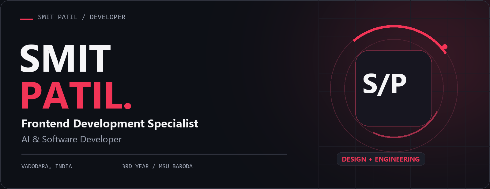
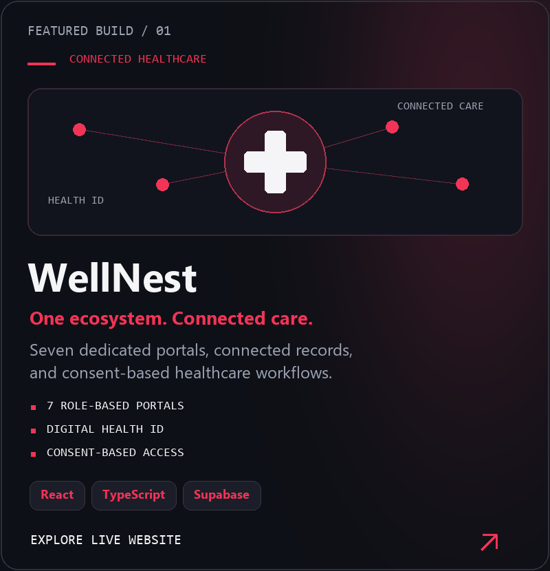
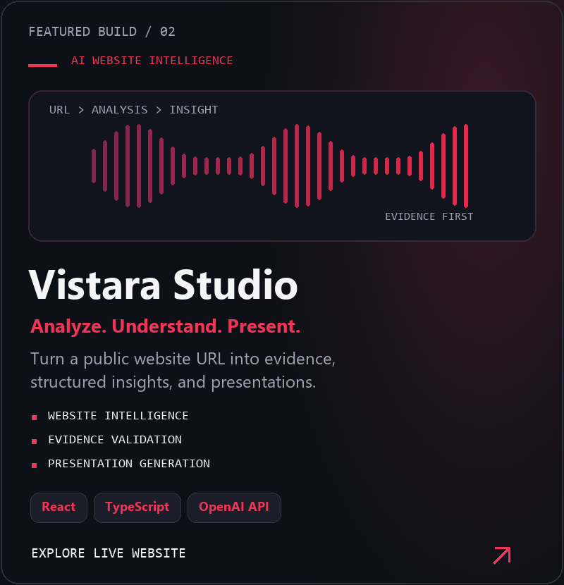
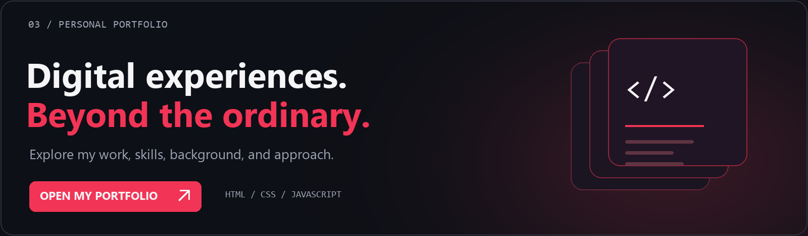
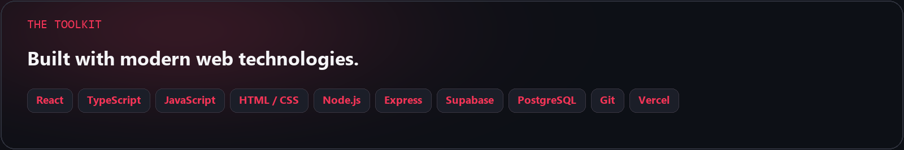

<!-- Custom artwork is hosted in this repository. All panels link to the actual projects. -->

**[EXPLORE MY PORTFOLIO](https://smit-patil-portfolio-eight.vercel.app/)** &nbsp; / &nbsp; **[CONNECT ON LINKEDIN](https://www.linkedin.com/in/smitpatil2008/)** &nbsp; / &nbsp; **[EXPLORE MY CODE](https://github.com/smitpatil1959-design?tab=repositories)**

I build responsive interfaces, connected web applications, and AI-powered products.  
**3rd Year, Diploma in Information Technology** · Polytechnic, The Maharaja Sayajirao University of Baroda

 

## Selected builds

<table>
<tr>
<td width="50%" valign="top">

<a href="https://wellnest-healthcare.vercel.app/"><strong>OPEN WELLNEST</strong></a>
&nbsp; / &nbsp;
<a href="https://github.com/smitpatil1959-design/WellNest-HealthCare">SOURCE CODE</a>

</td>
<td width="50%" valign="top">

<a href="https://vistara-studio-smitpatil1959-1013s-projects.vercel.app/"><strong>OPEN VISTARA STUDIO</strong></a>
&nbsp; / &nbsp;
<a href="https://github.com/smitpatil1959-design/Vistara-Studio">SOURCE CODE</a>

</td>
</tr>
</table>

 

<a href="https://smit-patil-portfolio-eight.vercel.app/"><strong>VISIT MY PORTFOLIO</strong></a>
&nbsp; / &nbsp;
<a href="https://github.com/smitpatil1959-design/MyPortfolio">VIEW SOURCE</a>

 

 
 

Designed with purpose. Built to be useful. Always improving.

